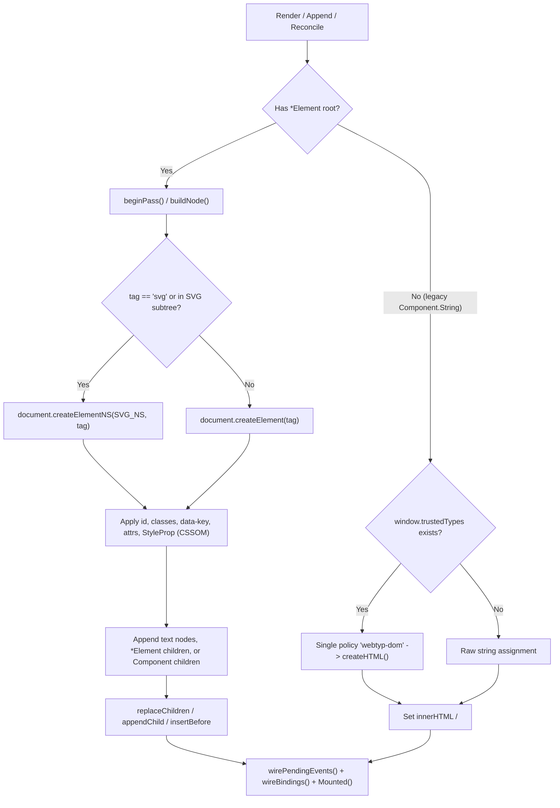

# DOM Mount Without `innerHTML`

Context: Under strict `Content-Security-Policy` (`require-trusted-types-for 'script'` and `style-src 'self'`), `dom` builds live DOM nodes directly instead of parsing HTML strings via `innerHTML` or `insertAdjacentHTML`, and applies dynamic inline CSS properties through CSSOM (`element.style.setProperty`).

## Walkthrough

1. `Render` clears the mount target with `parent.replaceChildren()` instead of setting `innerHTML = ""`.
2. When the component produces an `*Element` tree, `buildNode` constructs each node with `createElement` or `createElementNS("http://www.w3.org/2000/svg", tag)` for `<svg>` subtrees.
3. Attributes, classes, `data-key`, and initial signal-bound values are written with DOM APIs (`setAttribute`, `classList`), and `Element.StyleProp` calls `node.style.setProperty(prop, val)` without emitting any `style="..."` HTML attribute.
4. Child `*Element` nodes and text nodes (`createTextNode`) are appended recursively; `TrustedHTML` fragments or legacy string-only `Component`s pass through a single cached `trustedTypes.createPolicy("webtyp-dom", ...)` helper.
5. Finally, `wirePendingEvents`, `wireBindings`, and `Mounted` run identically to the previous mount lifecycle.
